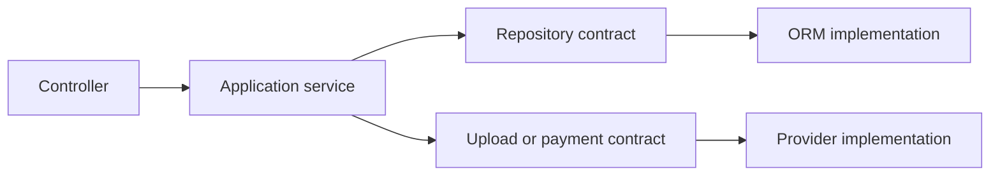

# DOC-004 — Conventions

**Status:** Accepted rules; proposals labeled · **Updated:** 2026-10-28.
**Format and reading:**

- [D-019 — Lightweight decision documentation](DOC-003-decisions.md#d-019--lightweight-decision-documentation)
- [D-020 — Task-based context loading](DOC-003-decisions.md#d-020--task-based-context-loading)
- [D-023 — Document identifiers and descriptive references](DOC-003-decisions.md#d-023--document-identifiers-and-descriptive-references)

**Decision:** Apply accepted rules below; keep proposals and open questions unresolved until the maintainer decides.

**Reason:** Provide a concise implementation reference without treating ideas as agreements.

Read the relevant section and its linked [DOC-003 — Decision Records](DOC-003-decisions.md), not the whole documentation set. Progress lives in the [DOC-002 — Project Task List](../task-list.md).

## 1. Documentation

**Status:** Accepted

**Records:**

- [D-004 — Decision records and conventions](DOC-003-decisions.md#d-004--decision-records-and-conventions)
- [D-015 — Concise English documentation](DOC-003-decisions.md#d-015--concise-english-documentation)
- [D-016 — AI collaboration and attribution](DOC-003-decisions.md#d-016--ai-collaboration-and-attribution)
- [D-017 — Versioned AI agreements and context recovery](DOC-003-decisions.md#d-017--versioned-ai-agreements-and-context-recovery)
- [D-018 — No improvisation and required clarification](DOC-003-decisions.md#d-018--no-improvisation-and-required-clarification)
- [D-019 — Lightweight decision documentation](DOC-003-decisions.md#d-019--lightweight-decision-documentation)
- [D-020 — Task-based context loading](DOC-003-decisions.md#d-020--task-based-context-loading)
- [D-023 — Document identifiers and descriptive references](DOC-003-decisions.md#d-023--document-identifiers-and-descriptive-references)

**Decision:** Use concise English, lightweight decision records, versioned agent rules, and task-based reading.

**Reason:** Preserve rationale and history with minimal repetition and context overhead.

- Write concise, clear English without losing context or technical meaning.
- Record each agreed decision with a stable ID and clear status. Decision and reason are required; add dates, context, consequences, alternatives, and review triggers only when useful.
- Use stable `DOC-XXX` document IDs in filenames and top-level titles; keep `D-XXX` IDs for decision records. Allocate the next unused document ID without renumbering or reusing earlier IDs.
- Keep standard root filenames: `README.md`, `AGENTS.md`, `task-list.md`, and `CODE_OF_CONDUCT.md`; show their document IDs in their titles. Keep `LICENSE` unchanged with its standard MIT identifier.
- Label document links `DOC-XXX — Document title`, adding a section when needed. Label decision references `D-XXX — Decision title`; name grouped historical ranges as well.
- IDs support sorting and lookup; continue loading documentation only when the current task requires it.
- Update affected conventions and tasks in the same change.
- Distinguish accepted decisions, proposals, and open questions.
- Preserve history when replacing a decision; link its successor and mark it superseded.
- Keep AI attribution and [DOC-001 — AI Contributor Guide](../AGENTS.md) accurate as the project evolves.
- Version AI working agreements separately from application releases; retain a dated changelog linked to decision records.
- After context compaction or agreement changes, reread AGENTS.md and load only relevant sections to recover scope, progress, questions, and approvals.
- AI assistants must not improvise or assume unclear requirements. Ask the maintainer about ambiguity or proposed deviations and wait before affected work; unanswered questions never imply approval.

## 2. Scope and priorities

**Status:** Accepted

**Records:**

- [D-005 — Scope and priorities](DOC-003-decisions.md#d-005--scope-and-priorities)
- [D-011 — External interaction examples](DOC-003-decisions.md#d-011--external-interaction-examples)

**Decision:** Build a template for solo developers or teams of 2–3, with authentication, configurable authorization, and 2–3 access-controlled CRUD examples.

**Reason:** Make flows easy to understand and changes inexpensive to control.

- Use Node.js and NestJS; exact versions and supporting software require supply chain review and approval.
- Example CRUD domains remain open.
- Optimize for understandable flows, delivery speed, clean code, easy debugging and review, and controlled change costs.
- Evaluate abstractions by how well they localize changes at a cost the maintainer understands.
- Code evolution is an initial goal; traffic, data volume, and availability targets remain open.
- Database, upload, and payment are example integration categories. Select concrete examples and depth when defining the first release.

## 3. Architecture

**Status:** Accepted principles; implementation details open

**Records:**

- [D-006 — N-layered architecture, DI, and contracts](DOC-003-decisions.md#d-006--n-layered-architecture-di-and-contracts)
- [D-009 — One modular application with layers per feature](DOC-003-decisions.md#d-009--one-modular-application-with-layers-per-feature)
- [D-010 — Behavioral contracts and integration boundaries](DOC-003-decisions.md#d-010--behavioral-contracts-and-integration-boundaries)

**Decision:** Use N-layered architecture in one application organized by feature, with DI and behavioral contracts; keep external implementations outside services.

**Reason:** Localize changes and make feature flows easy to trace.

- Contracts define available operations, behavior, and responsibility boundaries.
- Design boundaries to contain the impact of domain, ORM, and provider changes.
- Layer names, folders, contract forms, DI wiring, and import rules remain open.
- Deployment follows each project's needs and resources; logical layers do not prescribe physical tiers. Reference: [Microsoft N-tier guide](https://learn.microsoft.com/en-us/azure/architecture/guide/architecture-styles/n-tier), retrieved 2026-10-28.
- Exported Nest providers form a module's public API. Reference: [NestJS modules](https://docs.nestjs.com/modules), retrieved 2026-10-28.

### Proposed implementation

**Status:** Proposed.

- Start with controller → application service → repository/integration contract → infrastructure implementation.
- Controllers handle transport; services coordinate business flows; infrastructure handles technology details.
- Check business rules and resource access in services; pass required data-access constraints through repository contracts.
- Consider service contracts at controller–service boundaries; assess maintenance cost before standardizing interfaces.
- Use application-owned contract inputs and outputs; avoid exposing ORM models, query builders, transaction clients, or vendor SDK responses.
- Specify not-found behavior, errors, transaction boundaries, and relevant idempotency guarantees. Matching signatures alone is insufficient.
- Choose interface plus runtime DI token, or an abstract class. Reference: [NestJS custom providers](https://docs.nestjs.com/fundamentals/custom-providers), retrieved 2026-10-28.
- Consider focused contracts before introducing generic repositories or shared base services.

Proposed call flow; DI selects implementations and services depend on contracts:

### Change limits

Contracts contain change impact; they do not eliminate migration work. An ORM change can affect queries, migrations, transactions, and mapping. A payment provider change can affect capabilities, statuses, webhooks, and reconciliation. Domain changes may alter contracts themselves.

A move toward ports and adapters requires reviewing contract ownership, dependency direction, and framework coupling. Evaluate architecture changes against real benefits and migration costs.

## 4. Authorization

**Status:** Accepted requirements; policy model open

**Records:**

- [D-007 — Configurable authorization](DOC-003-decisions.md#d-007--configurable-authorization)
- [D-012 — Resource identity and access policies](DOC-003-decisions.md#d-012--resource-identity-and-access-policies)

**Decision:** Let superadmin control access using registered resource identities, adaptable delegation, and selected public access.

**Reason:** Reuse the template across projects with different access policies.

- Superadmin controls admin and user access; CRUD examples demonstrate restrictions.
- Register each protected resource type under a unique name/identifier in the database. This identifies the type, not an individual record.
- Whether admins may manage user access must be adaptable to project requirements; its rule model remains open.
- Some resources or operations allow unauthenticated access. `@Public()` is a candidate, not a selected mechanism.
- Superadmin/admin/user are initial actors; role structure, inheritance, and delegation details remain open.

### Proposed access model

**Status:** Proposed.

- Permissions express resource actions, such as `articles.read` or `articles.update`.
- Roles group permissions; checks also consider the relevant resource context.
- Separate allowed actions from data scope, such as own records versus all records.
- Deny by default and check access consistently, including individual resources. Reference: [OWASP authorization guidance](https://cheatsheetseries.owasp.org/cheatsheets/Authorization_Cheat_Sheet.html), retrieved 2026-10-28.

### Open questions

- Which policy allows admins to manage user access? Which permissions and target users may they manage?
- How do resource identifiers map to actions, data scopes, and permission-management rights?
- How is the resource catalog synchronized with code, including renames and deletion?
- Is public access defined in code, the database, or both? At what resource/operation granularity, and how does it interact with authorization?
- Are permissions assigned through roles, directly to users, or both?
- Are roles fixed or editable, and do they inherit permissions?
- Is own/all scope sufficient? Does “users below an admin” mean organizational hierarchy or roles?
- Does superadmin have unrestricted access, and how is the last administrator protected?
- When do permission changes or revocations affect active sessions/tokens?
- Which access changes need an audit trail?

## 5. External interaction examples

**Status:** Accepted; replaces [D-008 — Upload and payment isolation](DOC-003-decisions.md#d-008--upload-and-payment-isolation) scope

**Records:**

- [D-011 — External interaction examples](DOC-003-decisions.md#d-011--external-interaction-examples)
- [D-008 — Upload and payment isolation](DOC-003-decisions.md#d-008--upload-and-payment-isolation)

**Decision:** Demonstrate external I/O through contracts; choose database/upload/payment examples according to release scope.

**Reason:** Teach replaceable integrations without making every example a required feature.

- Select concrete database, upload, or payment examples for the first release; keep their implementations separate from application logic.
- Contracts limit caller dependence on provider details.
- Providers, SDKs, storage, implementation timing, exact contracts, and database transaction boundaries remain open.

Proposed responsibilities:

| Area | Application rules | Integration implementation |
| --- | --- | --- |
| Upload | Ownership, upload/read access, and links to business resources. | Store, retrieve, delete, and map provider identifiers. |
| Payment | Amount, currency, order links, and business status rules. | Gateway calls, webhook authenticity checks, and provider status mapping. |

Before implementing a selected example, define file authorization and validation, payment idempotency, duplicate/out-of-order webhooks, and consistency with business data as applicable.

## 6. Supply chain

**Status:** Accepted · **Record:** [D-002 — Software supply chain policy](DOC-003-decisions.md#d-002--software-supply-chain-policy).

**Decision:** Complete the full policy and obtain explicit approval before affected software steps.

**Reason:** Keep external software decisions evidence-based and under maintainer control.

Follow the full [DOC-005 — Global Software Supply Chain Security Policy](DOC-005-supply-chain-security.md) and its [DOC-002 — Project Task List: 7. Dependencies and supply chain](../task-list.md#7-dependencies-and-supply-chain).

Architecture references are neither artifact security audits nor approval to use software.

## 7. Project identity and attribution

**Status:** Accepted; conduct wording proposed

**Records:**

- [D-013 — Public GitHub repository](DOC-003-decisions.md#d-013--public-github-repository)
- [D-014 — Descriptive project name](DOC-003-decisions.md#d-014--descriptive-project-name)
- [D-015 — Concise English documentation](DOC-003-decisions.md#d-015--concise-english-documentation)
- [D-016 — AI collaboration and attribution](DOC-003-decisions.md#d-016--ai-collaboration-and-attribution)
- [D-021 — MIT license and downstream scope](DOC-003-decisions.md#d-021--mit-license-and-downstream-scope)
- [D-022 — Community conduct and reporting](DOC-003-decisions.md#d-022--community-conduct-and-reporting)

**Decision:** Use nest-layered-template, concise English, and evidenced AI attribution for a public repository.

**Reason:** Keep the project descriptive, easy to scan, and transparent about collaboration.

- Project and repository name: `nest-layered-template`. Prefer descriptive, distinctive, memorable wording.
- Repository description: “A modular NestJS backend starter with clear boundaries, explicit contracts, and flexible authorization.”
- The maintainer plans a public GitHub repository and handles commits and pushes.
- All repository documentation uses concise English.
- Use the standard [MIT License](../LICENSE), copyright 2026 salmanthoriq95. Preserve its terms; third-party licenses remain separate.
- Do not imply upstream support, endorsement, or operation of independent forks or deployments. Liability disclaimers are not a promise of universal legal immunity.
- Keep conduct rules separate from software-license permissions. GitHub reporting is approved; [DOC-009 — Code of Conduct](../CODE_OF_CONDUCT.md) remains proposed. Read [DOC-008 — Licensing and Community Scope](DOC-008-licensing.md) when working on these topics.
- Credit collaboration with OpenAI Codex in the README and agent guide.
- Available session identity: GPT-6 model family; exact variant unavailable. Do not infer a specific model ID from a product catalog.
